# UnforgottenBits

> **Description:** None  
> **Difficulty:** Hard

## 1. Khảo sát disk image và dữ liệu ban đầu

- Ta nhận được một file disk image. Sử dụng công cụ FTK Imager để đọc dữ liệu bên trong. 

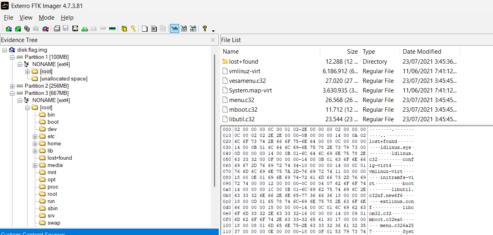

- Ta thấy disk image có 3 phân vùng, trong đó phân vùng 3 là phân vùng dùng để lưu trữ và truy cập dữ liệu của hệ thống. Tiến hành truy cập vào đường dẫn `root\home\yone`.

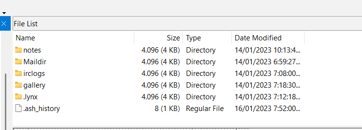

- Trong đây, ta thấy có 5 thư mục kèm với một file `.ash_history`. Đào sâu vào các thư mục này, ta thu được các thông tin sau.

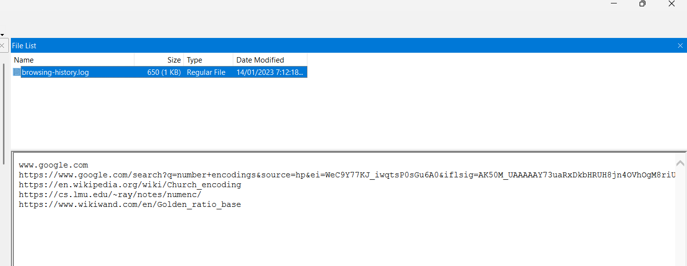

```
www.google.com
https://www.google.com/search?q=number+encodings&source=hp&ei=WeC9Y77KJ_iwqtsP0sGu6A0&iflsig=AK50M_UAAAAAY73uaRxDkbHRUH8jn4OVhOgM8riUqvVI&ved=0ahUKEwj-2r_EgL78AhV4mGoFHdKgC90Q4dUDCAk&uact=5&oq=number+encodings&gs_lcp=Cgdnd3Mtd2l6EAMyBggAEBYQHjIFCAAQhgMyBQgAEIYDMgUIABCGAzIFCAAQhgM6DgguEIAEELEDEIMBENQCOgsIABCABBCxAxCDAToRCC4QgAQQsQMQgwEQxwEQ0QM6CAgAELEDEIMBOgsILhCABBCxAxCDAToFCAAQgAQ6CAgAEIAEELEDOggILhCABBDUAjoHCAAQgAQQCjoHCC4QgAQQClAAWI0VYPAXaABwAHgDgAHDA4gB-iKSAQkwLjMuNS40LjOYAQCgAQE&sclient=gws-wiz
https://en.wikipedia.org/wiki/Church_encoding
https://cs.lmu.edu/~ray/notes/numenc/
https://www.wikiwand.com/en/Golden_ratio_base
```

- Ngoài ra, ta còn thu được 4 file ảnh `.bmp` và đoạn lịch sử trò chuyện:

```
[08:12] <yone786> Ok, let me give you the keys for the light.
[08:12] <avidreader13> I’m ready.
[08:15] <yone786> First it’s steghide.
[08:15] <yone786> Use password: akalibardzyratrundle
[08:16] <avidreader13> Huh, is that a different language?
[08:18] <yone786> Not really, don’t worry about it.
[08:18] <yone786> The next is the encryption. Use openssl, AES, cbc.
[08:19] <yone786> salt=0f3fa17eeacd53a9 key=58593a7522257f2a95cce9a68886ff78546784ad7db4473dbd91aecd9eefd508 iv=7a12fd4dc1898efcd997a1b9496e7591
[08:19] <avidreader13> Damn! Ever heard of passphrases?
[08:19] <yone786> Don’t trust em. I seed my crypto keys with uuids.
[08:20] <avidreader13> Ok, I get it, you’re paranoid.
[08:20] <avidreader13> But I have no idea if that would work.
[08:21] <yone786> Haha, I’m not paranoid. I know you’re not a good hacker dude.
[08:21] <avidreader13> Is there a better way?
[08:22] * yone786 yawns.
[08:24] <yone786> You’re ok at hacking. I’m good at writing code and using it
[08:24] <avidreader13> What language are you writing in?
[08:26] <yone786> C
[08:26] <avidreader13> Oh, I see.
[08:26] <yone786> I’m glad you like it. I’m sure you wouldn’t understand half of what I was doing.
[08:28] <avidreader13> I understand enough, but I do wish you wouldn’t take so much time with it.
[08:28] <yone786> Sorry. Well, I wish you could learn some things.
[08:29] <avidreader13> But it’s an incredible amount of time you spend on it.
[08:29] <yone786> Haha, don’t take it like that.
```

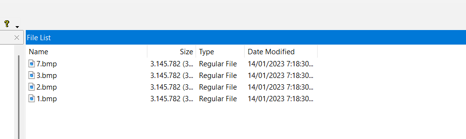

## 2. Trích xuất dữ liệu ẩn từ các ảnh BMP

- Có thể phỏng đoán rằng các bức ảnh trên được ẩn giấu thông tin bằng kỹ thuật `steghide` với password là `akalibardzyratrundle`.

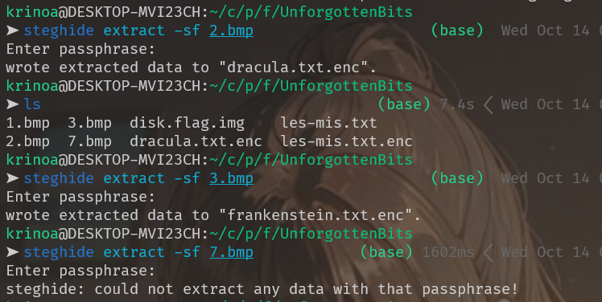

- Chỉ có bức ảnh tên `7.bmp` là không thể extract được nội dung ẩn. Tạm thời bỏ qua vấn đề đó, ta tiến hành giải mã AES theo cuộc trò chuyện mà ta thu được.

```
salt=0f3fa17eeacd53a9 key=58593a7522257f2a95cce9a68886ff78546784ad7db4473dbd91aecd9eefd508 iv=7a12fd4dc1898efcd997a1b9496e7591
```
- Đọc thử nội dung trong file [les-mis.txt](les-mis.txt), ta thấy đó là một phần truyện được trích xuất và ẩn vào ảnh để truyền sách lậu đi. Như vậy, ta dự đoán `7.bmp` cũng sẽ được giấu thông tin gì đó. Tuy nhiên, password và key AES sẽ không giống như ở 3 tấm kia. Tiến hành tìm kiếm tiếp trong các thư mục khác.

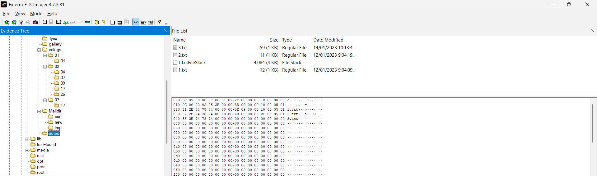

- Trong thư mục `root\home\yone\notes` có 3 file này. Trong đó có file [1.txt.FileSlack](1.txt.FileSlack) và file [3.txt](3.txt) là đáng nghi.

- Với nội dung thu được trong file `3.txt`, ta phỏng đoán rằng password để dùng Steghide trích xuất dữ liệu từ file `7.bmp` là chuỗi ký tự gồm tên của 4–5 tướng trong Liên Minh, bắt đầu bằng `yasuoaatrox...`.

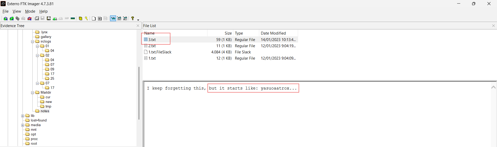

- Ta sẽ tiến hành tạo một file [wordlist](lol_steghide_wordlist.txt) theo yêu cầu trên và viết script để brute-force mật khẩu.

```python
#!/usr/bin/env python3
import argparse
import subprocess
import sys
from pathlib import Path


def main():
    parser = argparse.ArgumentParser(
        description="Test candidate passwords against a Steghide file."
    )
    parser.add_argument("image", help="Image containing embedded data")
    parser.add_argument("wordlist", help="One candidate password per line")
    parser.add_argument(
        "--output",
        default="extracted_payload.bin",
        help="Output path for extracted data",
    )
    args = parser.parse_args()

    image = Path(args.image)
    wordlist = Path(args.wordlist)

    if not image.is_file():
        sys.exit(f"[!] Không tìm thấy file ảnh: {image}")
    if not wordlist.is_file():
        sys.exit(f"[!] Không tìm thấy wordlist: {wordlist}")

    try:
        with wordlist.open("r", encoding="utf-8", errors="ignore") as f:
            passwords = [
                line.strip()
                for line in f
                if line.strip()
            ]
    except OSError as exc:
        sys.exit(f"[!] Không đọc được wordlist: {exc}")

    print(f"[*] Số mật khẩu cần thử: {len(passwords)}")

    for index, password in enumerate(passwords, start=1):
        result = subprocess.run(
            [
                "steghide", "extract",
                "-sf", str(image),
                "-p", password,
                "-xf", args.output,
                "-f",
            ],
            stdout=subprocess.DEVNULL,
            stderr=subprocess.DEVNULL,
            check=False,
        )

        if result.returncode == 0 and Path(args.output).is_file():
            print(f"\n[+] Tìm thấy mật khẩu: {password}")
            print(f"[+] Dữ liệu trích xuất: {args.output}")
            return

        if index % 100 == 0 or index == len(passwords):
            print(f"[*] Đã thử {index}/{len(passwords)}", end="\r")

    print("\n[-] Không tìm thấy mật khẩu trong wordlist.")


if __name__ == "__main__":
    main()
```

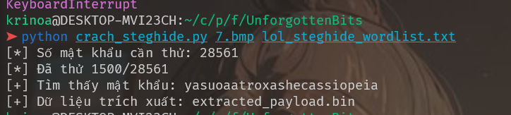

- Ta đã brute-force thành công mật khẩu Steghide của bức ảnh `7.bmp`. Thử kiểm tra file bằng các công cụ như `cat`, `strings` và `xxd`.

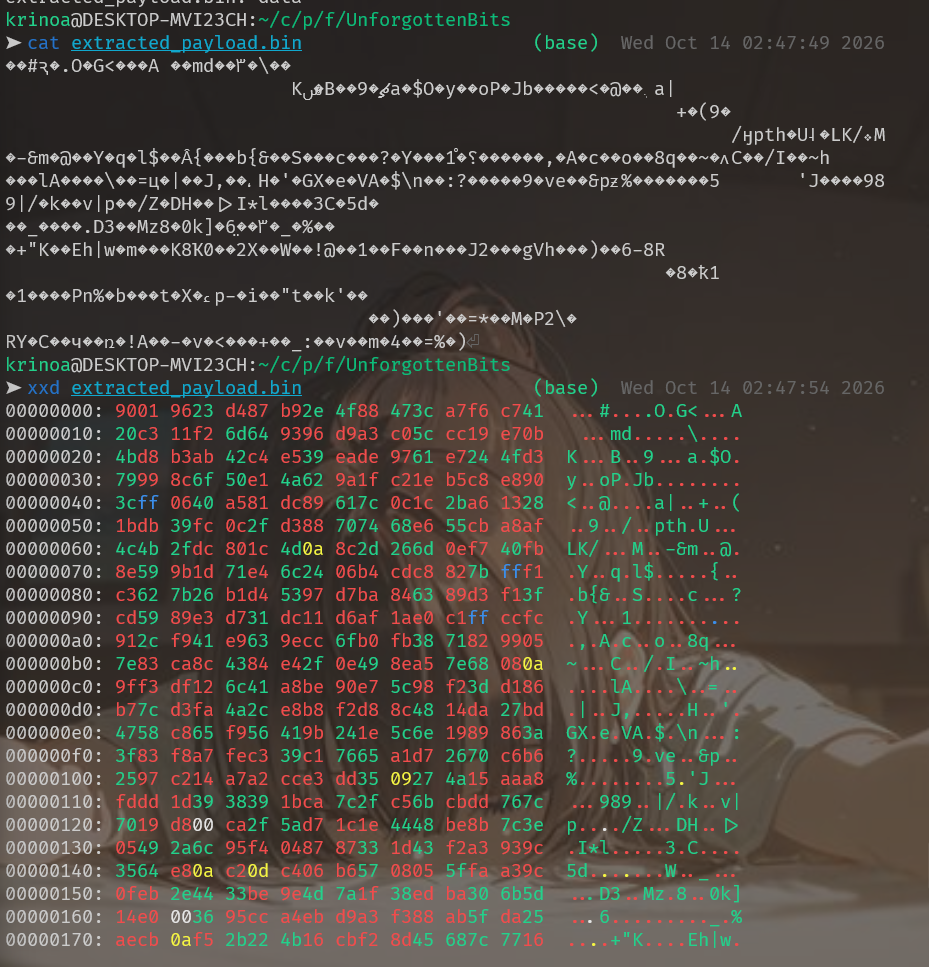

- Kết quả thu được khiến ta nghi ngờ rằng file này cũng được mã hóa AES, tương tự các file `1.bmp`, `2.bmp` và `3.bmp`. Thử giải mã tương tự như các file trên thì kết quả trả về là `bad decrypt`. 

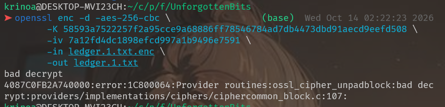

- Ta đặt nghi vấn về file [1.txt.FileSlack](1.txt.FileSlack) và lịch sử duyệt web đã thu được. 

### 3.1. Khảo sát `1.txt.FileSlack`

Trong quá trình điều tra, ta thu được hai file liên quan:

- `1.txt`: chứa chuỗi `chizazerite`.
- `1.txt.FileSlack`: chứa dữ liệu gồm các bit `0`, `1`, dấu chấm `.` và vùng byte NUL ở cuối.

Kích thước của `1.txt.FileSlack` là 4.084 byte. Khi kiểm tra dữ liệu, ta nhận thấy:

- 1.905 byte đầu tiên chứa chuỗi bit và dấu chấm.
- Trong đó có 1.778 bit nhị phân và 127 dấu chấm.
- Phần còn lại gồm 2.179 byte NUL.

Phần dữ liệu có ý nghĩa cần được phân tích là chuỗi 1.905 ký tự đứng trước vùng NUL.

### 1.2. Liên hệ với lịch sử duyệt web

Lịch sử duyệt web trước đó có các trang liên quan đến biểu diễn số, bao gồm Number Encodings, Church Encoding và Golden Ratio Base.

Trong số này, Golden Ratio Base là hướng đáng chú ý vì dữ liệu trong `1.txt.FileSlack` chỉ sử dụng hai chữ số `0` và `1`.

Hệ cơ số vàng sử dụng cơ số:

$$
\varphi=\frac{1+\sqrt{5}}{2}
$$

Một chuỗi bit có thể được diễn giải thành giá trị số theo các lũy thừa của $\varphi$, thay vì các lũy thừa của 2 như hệ nhị phân thông thường.

Đây là giả thuyết cần kiểm chứng bằng dữ liệu thực tế.

### 1.3. Xác định cấu trúc các khối

Ta có:

$$
1778+127=1905
$$

Và:

$$
1905=127\times15
$$

Điều này cho thấy chuỗi có thể được chia thành 127 khối, mỗi khối dài 15 ký tự.

Khi chia dữ liệu từ đầu thành các khối 15 ký tự, mỗi khối có dạng:

```text
01010010100.010
01001000100.010
01010000100.001
...
```

Mỗi khối gồm 11 bit ở bên trái dấu chấm và 3 bit ở bên phải dấu chấm.

Dấu chấm trong dữ liệu ban đầu xuất hiện sau mỗi đoạn 14 bit. Vì vậy, khi chia chuỗi liên tục thành khối 15 ký tự, các khối mới có cấu trúc 11 bit, dấu chấm, rồi 3 bit. Đây là bước căn chỉnh cần thiết để thử cách biểu diễn số bằng cơ số vàng.

### 1.4. Chuyển từng khối từ cơ số vàng thành ký tự

Với một khối có dạng:

$$
b_{10}b_9\ldots b_1b_0.c_1c_2c_3
$$

Giá trị của khối được tính theo công thức:

$$
x=\sum_{i=0}^{10} b_i\varphi^i
+\sum_{j=1}^{3} c_j\varphi^{-j}
$$

Trong đó:

-   $b_i$ là các bit thuộc phần nguyên, với vị trí được đánh số từ phải
    sang trái, bắt đầu từ $0$.
-   $c_j$ là các bit thuộc phần thập phân, với vị trí được đánh số từ
    trái sang phải, bắt đầu từ $1$.
-   Mỗi bit bằng $1$ đóng góp lũy thừa tương ứng của $\\varphi$; bit
    bằng $0$ đóng góp giá trị $0$.
-   $\\varphi$ là tỷ lệ vàng, được xác định bởi:

$$
\\varphi=\\frac{1+\\sqrt{5}}{2}\\approx 1.6180339887
$$

Sau khi tính được giá trị $x$, lấy phần nguyên bằng cách làm tròn lên:

$$
n=\\lceil x\\rceil
$$

Cuối cùng, chuyển $n$ thành ký tự ASCII tương ứng.

Thực hiện lần lượt với tất cả các khối dữ liệu, ta thu được chuỗi văn
bản chứa các tham số `salt`, `key` và `iv` phục vụ bước giải mã AES tiếp
theo.
### 1.5. Script Python tái hiện quá trình giải mã

Tạo file `decode_slack.py` trong cùng thư mục với `1.txt.FileSlack`:

```python
#!/usr/bin/env python3

import math
from pathlib import Path

INPUT_FILE = Path("1.txt.FileSlack")
OUTPUT_FILE = Path("slack_decoded.txt")


def decode_phinary(chunk, phi):
    integer_part, fractional_part = chunk.split(".")

    value = 0.0

    # Phần nguyên: các lũy thừa không âm của phi
    for i, bit in enumerate(reversed(integer_part)):
        if bit == "1":
            value += phi ** i

    # Phần phân số: các lũy thừa âm của phi
    for i, bit in enumerate(fractional_part, start=1):
        if bit == "1":
            value += phi ** (-i)

    return math.ceil(value)


def main():
    if not INPUT_FILE.is_file():
        raise FileNotFoundError(INPUT_FILE)

    raw = INPUT_FILE.read_bytes()

    # File slack có vùng NUL ở cuối.
    # Chỉ lấy phần dữ liệu ASCII đứng trước NUL đầu tiên.
    encoded = raw.split(b"\x00", 1)[0].decode("ascii")

    if len(encoded) != 1905:
        raise ValueError(
            f"Độ dài dữ liệu không như dự kiến: {len(encoded)}"
        )

    if any(ch not in "01." for ch in encoded):
        raise ValueError("Dữ liệu chứa ký tự ngoài 0, 1 và dấu chấm.")

    if len(encoded) % 15 != 0:
        raise ValueError("Dữ liệu không chia hết thành khối 15 ký tự.")

    chunks = [
        encoded[i:i + 15]
        for i in range(0, len(encoded), 15)
    ]

    phi = (1 + math.sqrt(5)) / 2
    result = []

    for index, chunk in enumerate(chunks, start=1):
        if chunk.count(".") != 1:
            raise ValueError(
                f"Khối {index} không có đúng một dấu chấm: {chunk}"
            )

        integer_part, fractional_part = chunk.split(".")

        if len(integer_part) != 11 or len(fractional_part) != 3:
            raise ValueError(f"Cấu trúc khối {index} không hợp lệ.")

        value = decode_phinary(chunk, phi)

        if not 0 <= value <= 127:
            raise ValueError(
                f"Khối {index} tạo mã ASCII ngoài phạm vi: {value}"
            )

        result.append(chr(value))

    decoded = "".join(result)

    OUTPUT_FILE.write_text(decoded, encoding="ascii")

    print("[+] Decoded text:")
    print(decoded)
    print(f"\n[+] Saved to: {OUTPUT_FILE}")


if __name__ == "__main__":
    main()
```

Sau khi chạy, ta thu được chuỗi OpenSSL dùng để mã hóa file đã trích xuất từ ảnh `7.bmp`.

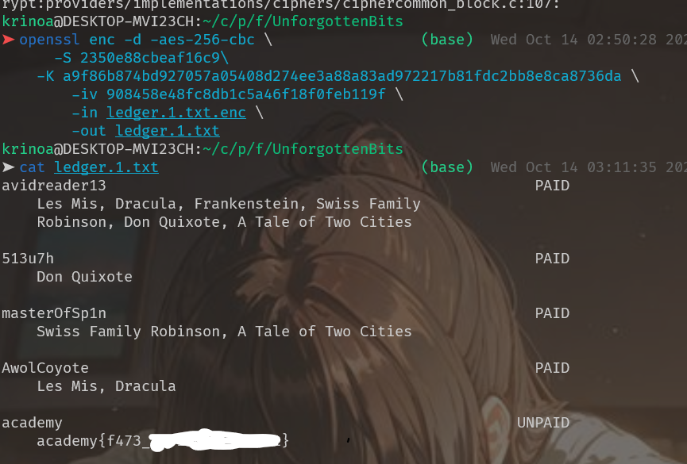


